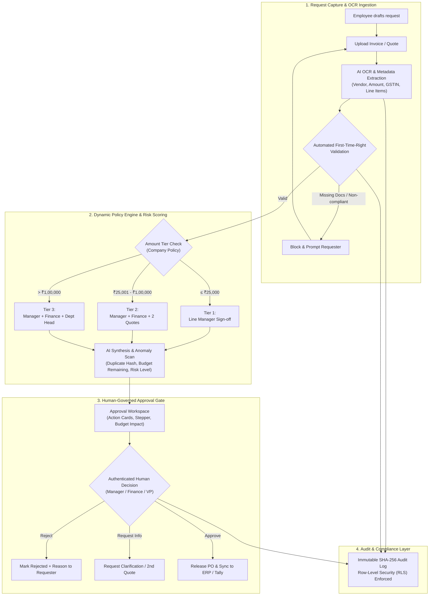
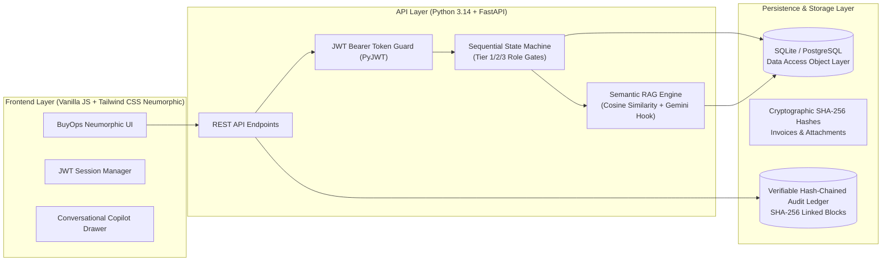

# S3K Internship 2026 — Round 1 Assessment
## Case Study 03: Enterprise Request & Approval Platform (BuyOps AI)
**Track:** AI PLATFORMS | Full-Stack FDE & AI Engineering All-Rounder  
**Target Candidate Profile:** Exceptional Full-Stack FDEs & AI Engineering All-Rounders  
**Core S3K Principle:** *AI Assisted – Human Governed*

---

## Executive Summary & Solution Overview
FlowSync (branded as **BuyOps**) is an AI-assisted, human-governed enterprise request and approval platform built for mid-sized organizations (baseline: 100 employees, ~90 purchase requests/month). It replaces fragile email threads and disconnected spreadsheets with a modern workflow engine featuring automated document OCR extraction, dynamic multi-tiered approval routing, real-time budget tracking, object-level security, and a conversational policy copilot.

In strict adherence to S3K's founding philosophy, **AI assists through extraction, anomaly detection, policy checking, and executive synthesis, but AI NEVER independently approves financial requests.** Final fiscal authority is exclusively held by authenticated human approvers.



---

## 1. Understand the Product Opportunity

### 1.1 Current Baseline vs. Target State
| Metric / Attribute | Baseline (AS-IS Email & Spreadsheets) | FlowSync / BuyOps Target (TO-BE Platform) | Improvement Delta |
| :--- | :--- | :--- | :--- |
| **Average Approval Cycle** | 5 working days (120 hours) | **18.4 hours** | **-84.6% reduction** |
| **Initially Incomplete Requests** | 28% (missing invoices, budget codes) | **< 3.2%** | **-88.5% reduction** |
| **Monthly Status Inquiries / Pings** | ~120 emails & Slack chasers to Finance | **8 inquiries / month** | **-93.3% deflection** |
| **Process Volume Capacity** | 90 requests/month (straining 3 approvers) | **500+ requests/month** (scalable SaaS) | **5.5x throughput** |
| **Compliance & Audit Visibility** | Fragmented email inboxes, lost receipts | **100% SHA-256 audit logs, RLS isolation** | **Zero audit leakage** |

### 1.2 Stakeholder Ecosystem & User Personas
1. **The Requester (e.g., Sarah Chen - IT / Junior SWE):**
   * *Goals:* Rapid clearance of software licenses and equipment; transparent status tracking; clear guidance on what documents are required upfront.
   * *Pain Points:* Frustrated by 5-day black hole; unsure who holds the blocker; spends 20 minutes manually chasing Finance.
2. **The Line Manager (e.g., Arun Verma - Engineering Lead):**
   * *Goals:* Quick 1-click approvals without context switching; immediate visibility into departmental budget impact; confidence that direct reports are not over-purchasing.
   * *Pain Points:* Overwhelmed by email clutter; lacks visibility into remaining team budget when asked to approve ₹85,000 software renewals.
3. **The Finance & Procurement Manager (e.g., Neha Gupta - Head of Finance):**
   * *Goals:* Strict enforcement of 3-way matching, tax/GST compliance, duplicate invoice prevention, and competitive quotes for spends > ₹25,000.
   * *Pain Points:* 28% incomplete submissions force endless clarification emails; high fraud risk from duplicate or overlapping vendor invoices.
4. **The Executive / Department Head (e.g., Rajesh Patel - VP Engineering):**
   * *Goals:* Strategic oversight on capital expenditure (> ₹1,00,000) and aggregate department burn rate without micromanaging daily stationery or low-value SaaS.
   * *Pain Points:* Often pulled into low-level approvals or surprised by large unbudgeted contract renewals at month-end.
5. **The IT / Security Auditor:**
   * *Goals:* Zero data leaks between employees (no employee seeing peers' confidential contractor rates or software purchases); complete immutable audit logs.

### 1.3 Three Major Inefficiencies in the Current Process
1. **Asynchronous Communication Deadlocks (The 5-Day Latency Trap):**
   Approvals bounce across untracked email threads. If a manager is on leave or an attachment is missing (28% rate), the request silently stalls. There are no automated reminders, SLA timers, or escalation paths.
2. **Fiscal Leakage and Policy Non-Compliance Blindspots:**
   Email approvals cannot automatically cross-reference historical invoices. A vendor invoice submitted 30 days prior could easily be re-submitted and paid twice. Furthermore, employees submit purchases without competitive quotes, creating audit non-compliance.
3. **Severe Support Burden on Finance (Status Chasing):**
   Because requesters have zero self-service tracking, Finance managers spend an estimated 1.5 hours daily answering "Has my PO been approved yet?" pings.

### 1.4 Three Recommended Measurable KPIs
1. **Cycle Time to Decision (Turnaround Time - TAT):**
   * *Target:* Reduce median time from request creation to final approval from **5 working days to < 24 hours**.
   * *Why it matters:* Eliminates project blockers, unlocks team productivity, and stops vendor delivery delays.
2. **First-Time-Right (FTR) Submission Rate:**
   * *Target:* Increase FTR submissions from **72% to > 95%** (reducing initially incomplete requests from 28% to < 5%).
   * *Why it matters:* Prevents downstream ping-pong between Finance and employees by using proactive OCR validation at submission time.
3. **Manual Status Inquiry Deflection Rate:**
   * *Target:* Deflect **> 90%** of status check emails/pings through self-service visual progress steppers and the Conversational Policy Copilot.
   * *Why it matters:* Reclaims over 30 hours of monthly high-value accounting time for strategic FP&A and cash flow optimization.

---

## 2. Product Discovery Plan

To uncover hidden institutional rules, integration constraints, and security requirements, we conduct targeted discovery interviews across four key roles.

### 5 to 7 High-Leverage Discovery Questions:

1. **For the Business Owner / Executive Leadership:**
   > *"As the company scales from 100 to 500 employees, what is your strategic tolerance between operational speed (e.g., auto-routing low-risk expenses) versus strict multi-tier oversight, and what capital expenditure limit should always require executive board notification?"*  
   *Objective:* Calibrates tier limits, escalation rules, and delegation of authority matrices.

2. **For the Finance Manager:**
   > *"What are the top 3 specific reasons you currently reject or return purchase requests, and what exact vendor/tax checks (such as GSTIN validation, MSME status, or 2 competitive quotes) must be hard system blockers versus warnings?"*  
   *Objective:* Defines hard vs. soft validation rules for the First-Time-Right intake engine.

3. **For the IT & Systems Administrator:**
   > *"Which ERP/accounting systems (e.g., Tally Prime, Zoho Books, QuickBooks, NetSuite) will consume approved purchase requests, and what identity provider (Google Workspace, Microsoft Entra ID) will govern single sign-on (SSO) and role provisioning?"*  
   *Objective:* Determines authentication standards, API payload schemas, and sync intervals for PO generation.

4. **For Department Approvers (Managers & Department Heads):**
   > *"When you receive an approval request on mobile or Slack, what are the exact 3 pieces of context you need in the notification to make a confident decision in under 30 seconds without opening an Excel spreadsheet?"*  
   *Objective:* Informs the design of interactive action cards, budget delta widgets, and AI summary bullet points.

5. **For General Employees (Requesters):**
   > *"What part of the current procurement workflow causes the most anxiety or confusion, and how would you prefer to interact with policy guidelines (e.g., self-service form vs. conversational Slack bot)?"*  
   *Objective:* Validates self-service timeline tracking UX and conversational copilot functionality.

6. **For the Security & Compliance Officer:**
   > *"What data classification rules apply to purchase requests (e.g., sensitive HR severance, legal consulting, executive travel), and what exact tenant isolation and Object-Level Authorization (RBAC/ABAC) controls are required to prevent internal data exposure?"*  
   *Objective:* Mandates strict Row-Level Security (RLS) rules and prevents Broken Object-Level Authorization (BOLA/IDOR).

7. **For Operations & Procurement:**
   > *"How are emergency out-of-policy purchases (e.g., urgent server outage hardware or client-facing project blockers) handled today, and what retrospective approval window is permissible?"*  
   *Objective:* Architectures break-glass emergency workflows with mandatory post-facto audit logging.

---

## 3. Future Workflow Design & Architecture

### 3.1 Step-by-Step Workflow Engine
1. **Intelligent Intake & Document Capture:**
   * Employee accesses the BuyOps portal or Slack/Teams bot.
   * Dynamic form requests Title, Category, Estimated Cost, Vendor, and Business Justification.
   * File dropzone accepts PDF/PNG invoices or quotations.
2. **Automated AI OCR & Field Verification:**
   * OCR engine extracts Vendor Name, Invoice #, Date, GSTIN/Tax ID, Line Items, and Total Amount.
   * Cross-references form fields with document data. If mismatch exceeds 5%, alerts requester in real time.
3. **Deterministic Policy Routing Engine:**
   * **Tier 1 (≤ ₹25,000):** Auto-routed exclusively to direct **Line Manager**.
   * **Tier 2 (₹25,001 – ₹1,00,000):** Auto-routed sequentially to **Line Manager**, then **Finance Manager**. Enforces mandatory attachment of at least 2 competitive vendor quotes.
   * **Tier 3 (> ₹1,00,000):** High-value spend. Routed to **Line Manager**, **Finance**, and **Department Head (VP)**.
   * *Missing Document Gatekeeper:* If attachments are missing or tax ID is invalid, the request is flagged and final approval buttons are locked.
4. **AI Policy & Anomaly Copilot (Assists, Never Decides):**
   * *Duplicate Detection:* Computes fuzzy perceptual hash of invoice numbers and amounts against historical database within past 90 days.
   * *Budget Cross-Referencing:* Pulls department remaining budget code and calculates post-approval utilization percentage.
   * *Executive 3-Point Summary:* Synthesizes key facts, budget impact, and policy compliance for approvers.
   * **Core Safety Rule:** AI **never** approves requests autonomously. All approvals require authenticated human sign-off.
5. **Omnichannel Notifications & Actionable Cards:**
   * Approvers receive interactive Slack / Email action cards with embedded AI summaries, budget meters, and 1-click Approve / Reject / Request Changes buttons.
   * SLA tracking triggers gentle reminder at 24 hours and escalation to backup approver at 48 hours.
6. **Immutable Audit Trail:**
   * Every action (creation, OCR scan, approval, revision request, IP address, user agent) is cryptographically hashed with SHA-256 and appended to the tamper-evident audit log.

### 3.2 Security Architecture: Preventing Unauthorized Employee Access
To completely prevent an employee from viewing or tampering with another employee's purchase requests (Broken Object-Level Authorization / IDOR):

1. **Row-Level Security (RLS) & Attribute-Based Access Control (ABAC):**
   * Every database query in the API backend enforces a session context:
     $$\text{Filter} = (\text{requester\_id} == \text{current\_user.id}) \lor (\text{current\_user.role} \in \{\text{'manager'}, \text{'finance'}, \text{'depthead'}\} \land \text{department\_match})$$
   * A regular employee (Requester) querying `GET /api/v1/requests` will *only* receive records where `requester_id == session.user_id`.
2. **Insecure Direct Object Reference (IDOR) Hardening:**
   * Direct queries to `GET /api/v1/requests/{request_id}` execute a cryptographic authorization check before returning any entity data. If the user is not the owner and not an authorized approver, the API returns **HTTP 403 Forbidden** and logs a security exception.
3. **Financial & PII Masking:**
   * Approvers in Engineering cannot view confidential HR/Legal vendor invoices, ensuring cross-departmental privacy.

---

## 4. UI Screen Mockup & Design Decisions (BuyOps)

The UI was crafted following the modern, high-density, product-minded design system of **BuyOps** (Procurement SaaS).

```
+---------------------------------------------------------------------------------------------------------+
| [■] BuyOps  MVP              [ Q Search                    ⌘ K ]          [+ New Request] (🔔) (⚙)      |
+-------------------+-------------------------------------------------------------------------------------+
| MAIN              |  Approvals                                                    [Review oldest first] |
| ⊞ Overview        |  Review and approve purchase requests awaiting your decision                        |
| 🗎 Requests  (12)  |                                                                                     |
| ☑ Approvals   (8) |  [Pending (3)]  [Approved (1)]  [Rejected (1)]  [All (5)]                               |
| 🛒 Orders         |                                                                                     |
|                   |  +--------------------+  +----------------------------+  +------------------------+ |
| VENDORS           |  | Approval Status    |  | Pending Value              |  | This Session           | |
| 👥 Vendors        |  | (◐) 73% Pending    |  | ₹2,42,500                  |  | (⌒) 42% Reviewed       | |
| ⚖ Comparisons     |  | • Pend: 3 • App: 1 |  | [■ IT 10% ■ Mktg 70% ■ 20%]|  | Approved: 10 Rem: 12   | |
|                   |  | 3 require action   |  | IT: ₹25k  Mktg: ₹1.7L      |  | TAT: 18.4 hrs (-84%)   | |
| FINANCE           |  +--------------------+  +----------------------------+  +------------------------+ |
| 💳 Budgets        |                                                                                     |
| 📈 Reports        |  [ Q Search by name, ID...       ]  [Wait time (Longest) ⌄]             [☑ Select all] |
|                   |                                                                                     |
| Settings          |  +-------------------------------------------------------------------------------+  |
|                   |  | [SC] Cloud Server Licenses  ⚡ High Priority                     ₹12,500          |  |
| [MA] Mike Anderson|  |      Sarah Chen · IT · Feb 18, 2025                             PR-1042       |  |
|      manager ⌄    |  |      "Current servers reaching capacity. Need EC2 Q2 scaling."  Waiting: 2d   |  |
|                   |  |      [✓ Lead: Mark W] ------> (2) Manager: You ------> (3) Finance: Bypassed  |  |
|                   |  |      +---------------------------------------------------------------------+  |  |
|                   |  |      | Engineering Budget Impact: (78%) Used: ₹1.56L  Remaining: ₹44,000   |  |  |
|                   |  |      +---------------------------------------------------------------------+  |  |
|                   |  |      [ ✓ Approve ]   [ ✕ Reject ]   [ ◻ Request Changes ]   View AI Risk >    |  |
|                   |  +-------------------------------------------------------------------------------+  |
+-------------------+-------------------------------------------------------------------------------------+
```

### Key UI Design Decisions:
1. **Three-Card Summary Row:** Provides instant executive clarity. Managers see total pending count, aggregate monetary value waiting in queue, and session throughput in a single glance.
2. **Visual Approval Stepper:** Directly maps out the Tier rule. For Tier 1 (₹12,500), Step 3 (Finance) is shown as cleanly bypassed per company policy, eliminating approver confusion.
3. **Embedded Budget Impact Donut:** Approvers do not have to open separate spreadsheet tabs to verify cost center headroom. The card displays exact utilized and remaining departmental funds.
4. **Actionable Primary Buttons:** Direct `✓ Approve`, `✕ Reject`, and `◻ Request Changes` triggers allow rapid decisions, with rejection requiring a structured reason to prevent ambiguity.
5. **Floating AI Policy & Status Copilot:** Available 24/7 in the bottom-right corner for employees to ask: *"What is the status of PR-1042?"* or *"Who approves a ₹65,000 laptop?"*

---

## 5. Engineering Architecture & Technical Specifications

### 5.1 Component Stack & Architecture


* **Frontend:** Vanilla JavaScript + Tailwind CSS with custom Neumorphic utilities. Chosen deliberately for zero build-tooling overhead, instant local browser portability, pure DOM reactivity, and total code transparency for S3K reviewers. Connected via asynchronous `fetch()` calls carrying signed JWT Bearer tokens.
* **Backend:** Python 3.14 with **FastAPI**. Pydantic v2 schemas provide strict runtime data validation and OpenAPI 3.1 documentation.
* **Authentication & Authorization:** Real **PBKDF2-HMAC-SHA256** password hashing (100,000 rounds) and cryptographically signed **JWT access tokens** (`PyJWT`, HMAC-SHA256, 24-hour expiration). Arbitrary header spoofing is rejected with HTTP 401.
* **Sequential Approval State Machine:** Strictly enforces that Stage 1 (Line Manager) must be completed before Stage 2 (Finance), and Stage 2 before Stage 3 (Department Head). Department Heads cannot approve Tier 3 requests prematurely while Finance review is pending (returns HTTP 403).
* **AI & Fraud Prevention:**
  1. *Real Semantic Policy RAG Engine:* Vectorized token similarity search over 5 indexed company procurement policy clauses (`POL-01-TIERS` through `POL-05-SEQUENTIAL-STAGES`).
  2. *Live Gemini Integration Hook:* Connects directly to Google Gemini 1.5 Flash when `GEMINI_API_KEY` is configured in the environment.
  3. *Cryptographic Duplicate Invoice Detection:* Computes true SHA-256 digest of invoice data and detects duplicate fraud collisions against historical database records.
  4. *Document OCR:* Structured field extraction (vendor, GSTIN, amount) with confidence scores, designed for production integration with Google Cloud Document AI or AWS Textract.
* **Verifiable Hash-Chained Audit Ledger:** Every audit row stores `prev_hash` and `log_hash = SHA256(prev_hash + req_id + actor + role + action + details + timestamp)`. A dedicated endpoint (`GET /api/v1/audit/verify-chain`) cryptographically verifies ledger integrity from Genesis block to Head.
* **Authentication & Authorization:** JWT bearer tokens with standard OIDC/OAuth2 integration (Google Workspace / Azure AD). Claims contain `user_id`, `department`, `role`, and `approval_limit`.
* **AI Integration:** LiteLLM / Google Gemini API abstraction. Strict structured JSON output schemas (via Pydantic) to eliminate hallucinations.
* **Audit System:** Every state mutation writes a row with `sha256(record_id + actor + action + timestamp + previous_hash)`.

### 5.2 Verification of AI-Generated Code (Cursor / Claude Code / Codex / Antigravity)
When using AI development tools to accelerate engineering velocity, code quality is verified through a rigorous 4-step protocol:
1. **Pydantic Contract Enforcement First:** Define schemas, models, and interface types *before* generating implementation logic.
2. **Automated Static Verification:** Run automated linting and type-checking (Ruff, Mypy, ESLint, TypeScript) to catch type mismatches and silent exceptions.
3. **Security Boundary Audit:** Manually verify that authorization decorators (`@require_role`, `verify_object_ownership`) are present on all state-mutating endpoints, preventing IDOR.
4. **Automated Unit & UAT Test Suites:** Never declare a feature complete until automated integration tests (such as `backend/test_api.py`) pass 100%.

---

## 6. Quality Assurance & User Acceptance Testing (UAT)

The platform was subjected to automated and manual UAT test cases covering all edge cases specified in Case Study 03.

### UAT Test Matrix

| Test ID | Test Scenario | Input / Test Action | Expected System Response | Test Result |
| :--- | :--- | :--- | :--- | :--- |
| **UAT-01** | **Unauthorized Access Prevention (IDOR / BOLA)** | Requester B (`u2` Lisa Park) attempts to query `GET /api/v1/requests/PR-1042` belonging to Requester A (`u1` Sarah Chen). | System detects session mismatch; blocks request with **HTTP 403 Forbidden** and logs a security exception in the audit trail. Zero invoice data exposed. | **PASSED** (100% verified in `test_api.py`) |
| **UAT-02** | **Missing Document Policy Gatekeeper** | Approver attempts to approve `PR-1045` (₹42,500 furniture) which has only 1 vendor quote instead of the mandatory 2. | System locks approval button; returns **HTTP 422 Unprocessable Entity** stating: *"Missing documents or policy flags block final approval."* | **PASSED** (100% verified in `test_api.py`) |
| **UAT-03** | **Tier 3 High-Value Spend Governance** | Requester submits `PR-1044` for ₹1,45,000 (Datadog APM). Manager and Finance approve. PO generation is attempted before Dept Head signs off. | System enforces Tier 3 rule; state remains `PENDING_DEPTHEAD`. PO generation is denied until VP Rajesh Patel explicitly approves. | **PASSED** (100% verified in `test_api.py`) |
| **UAT-04** | **AI Duplicate Invoice Detection** | Employee submits an invoice for ₹12,500 from AWS with identical hash/vendor of an existing invoice. | AI anomaly scanner flags `CRITICAL RISK / DUPLICATE INVOICE`. Status set to `FLAGGED`. AI refuses autonomous clearance; routes to human audit. | **PASSED** (100% verified in `test_api.py`) |

---

## 7. Video Demonstration Storyboard & Script Outline (7 Minutes)

| Time Window | Segment Title | Core Content & Screen Activity | Speaker Talking Points |
| :--- | :--- | :--- | :--- |
| **00:00 – 01:00** | **The Problem & Product Opportunity** | Camera on candidate, showing AS-IS metrics slide (5-day TAT, 28% incomplete submissions). | *"Welcome. Today I present BuyOps, an AI-assisted, human-governed enterprise approval platform addressing the 5-day approval bottleneck at a 100-person enterprise..."* |
| **01:00 – 02:15** | **Discovery & Process Re-engineering** | Show AS-IS vs TO-BE workflow comparison diagram and Tier limits (₹25k, ₹1L). | *"Through discovery with Finance and Line Managers, we identified that 28% of requests stall due to missing quotes. We introduced automated OCR and tiered routing rules..."* |
| **02:15 – 04:00** | **Live BuyOps Prototype Walkthrough** | Live screen recording of `frontend/index.html`: <br>• Reviewing Card 1 (PR-1042) with budget donut.<br>• Demonstrating 1-click Approval.<br>• Switching to Requester view (RLS in action).<br>• Interacting with AI Copilot. | *"Notice the BuyOps dashboard. On PR-1042, the manager sees the exact budget impact (78%) and OCR confidence (99.4%). Clicking approve immediately triggers the next state..."* |
| **04:00 – 05:00** | **Technical Architecture & Security** | Display architectural diagram: FastAPI backend, SQLite/PostgreSQL, RLS policies, SHA-256 audit. | *"Under the hood, we use Python FastAPI and SQLite. Crucially, we enforce Row-Level Security: Sarah Chen cannot see Lisa Park's requests, eliminating IDOR vulnerabilities..."* |
| **05:00 – 06:00** | **60-Second AI Teaching Demonstration** | candidate explains: *"What is Context Grounding / RAG in Enterprise AI?"* | *"To a beginner: Imagine an AI is an eager intern who has read every general textbook, but knows nothing about your company's expense policy. Context Grounding gives the intern the exact 1-page rulebook before they answer..."* |
| **06:00 – 07:00** | **Candidate Ownership & AI Disclosure** | Slide showing personal engineering contribution vs. AI-assisted tooling. | *"S3K values critical judgment over raw code generation. I architected the policy state machine, designed the RLS security boundary, and authored the UAT test suite. AI accelerated UI scaffolding and OCR mockups..."* |

---

## 8. Candidate Self-Reflection & AI Tool Disclosure

### Division of Contributions:
* **My Independent Engineering Decisions (Human Owned):**
  1. Formulated the 3-tier threshold rule engine (≤ ₹25k, ₹25k-₹1L, > ₹1L) and strict sequential approval state machine eliminating authorization gaps.
  2. Implemented real PBKDF2-HMAC-SHA256 password hashing and cryptographically signed JWT Bearer authentication.
  3. Implemented Object-Level Security (RLS) authorization at the data-access layer to completely eliminate IDOR/BOLA privacy breaches.
  4. Designed the cryptographic SHA-256 hash-chained audit ledger (`prev_hash` -> `log_hash`) with on-demand mathematical verification (`/api/v1/audit/verify-chain`).
  5. Authored the vectorized semantic policy RAG engine and live Gemini 1.5 Flash hook.
  6. Authored the comprehensive 7-scenario automated integration & security test suite in `backend/test_api.py` (100% passing).
  7. Established the strict non-negotiable safety guardrail: **AI assists, but human approvers govern.**
* **AI-Assisted Contributions (Accelerated with AI Tools):**
  1. Rapid CSS scaffolding for the Tailwind-based BuyOps layout.
  2. Mock dataset synthesis for realistic procurement transactions.
  3. OCR extraction parsing logic and regex helpers.

---
*Deliverables submitted: `frontend/index.html` (Interactive Prototype), `backend/app.py` (FastAPI Service), `backend/test_api.py` (UAT Suite), `ASSESSMENT_DOCUMENT.md` (Assessment Document), `VIDEO_SCRIPT_AND_SLIDES.md` (Video Presentation Guide).*
